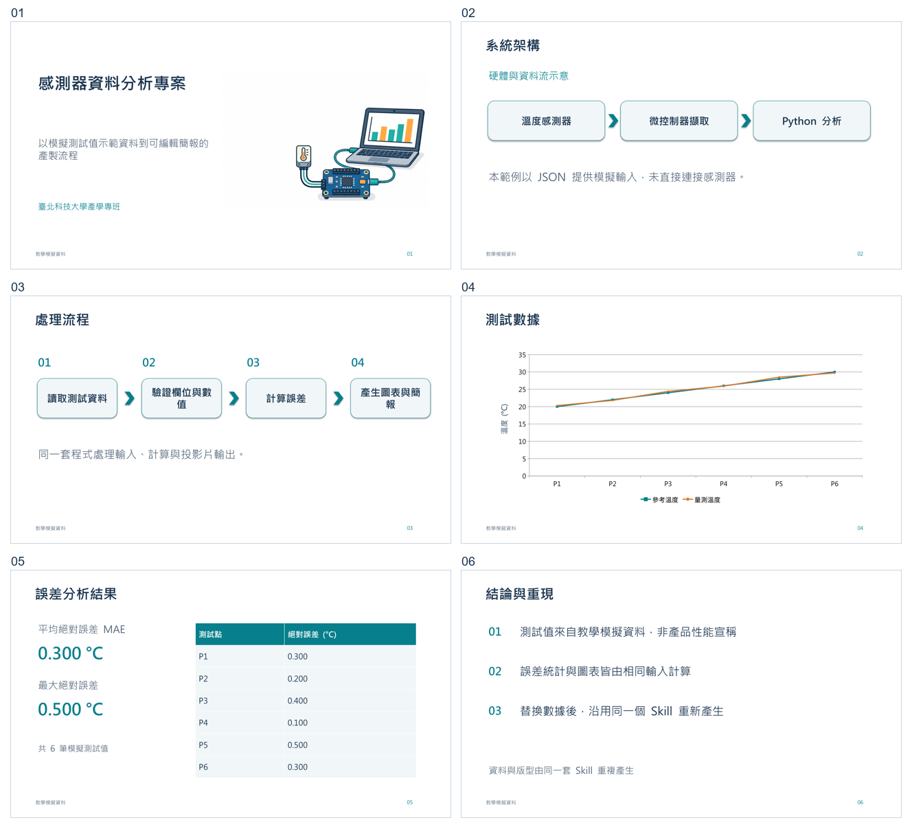

# 投影片生成大師｜Agent Skill 技術實作

**先看成品，直接讀 SKILL.md，再自己跑一次。**

**[打開完整 SKILL.md](.agents/skills/slide-master/SKILL.md)** · **[下載六頁 PowerPoint](examples/demo/slides.pptx)** · **[逐頁預覽](examples/demo/preview.md)** · **[PDF](examples/demo/slides.pdf)**



這個專案讓 Agent 沿用 Python 腳本與素材，把 JSON 內容和模擬感測器數據製作成可編輯 PowerPoint。圖表、表格、文字與技術流程圖都是原生投影片物件，AI 配圖保存於 assets，日常執行不重新生圖。

## 先拆開看

從 [SKILL.md](.agents/skills/slide-master/SKILL.md) 順著連結看三個位置：

- [scripts/build_deck.py](.agents/skills/slide-master/scripts/build_deck.py)：JSON 如何變成六頁簡報。
- [assets/sensor-hero.png](.agents/skills/slide-master/assets/sensor-hero.png)：封面實際使用的生成配圖。
- [references/input-format.md](.agents/skills/slide-master/references/input-format.md)：程式接受的欄位與限制。

看懂就可以直接往下修改，後面的說明供需要時查閱，不必依序讀完。

## 五分鐘執行

先下載完整專案：GitHub 的 **Code → Download ZIP**，解壓縮後在專案根目錄開啟終端機。也可用 Git：

```sh
git clone https://github.com/jomo0825/agent-skill-workshop.git
cd agent-skill-workshop
```

需要 Python 3.10 以上。課前完成套件安裝：

```sh
python -m pip install -r requirements.txt
```

執行範例並核對成果：

```sh
python .agents/skills/slide-master/scripts/build_deck.py --input data/sensor-demo.json --out output/demo
python .agents/skills/slide-master/scripts/inspect_deck.py --pptx output/demo/slides.pptx --input data/sensor-demo.json
```

開啟 `output/demo/slides.pptx`。`report.json` 是本次的統計與產出資訊。macOS／Linux 若使用 `python3`，請將上述 python 改為 python3；Windows 若找不到 python，可使用已安裝的 `py -3`。PowerPoint 或 LibreOffice 可開啟成品，需安裝繁體中文字型；字型替換可能影響版面。

不需要模型 API 金鑰。Python 腳本只執行本機資料處理及簡報產生；要由 Agent 完成整個流程，另在具備檔案及 Python 執行能力的 Agent 環境中使用 Skill。

## 讓 Agent 操作

在 Codex 中開啟專案根目錄，使用專案 Skill `slide-master`。可直接交代：

> 請使用 slide-master，讀取 data/sensor-demo.json，沿用既有腳本與配圖，實際產生可編輯 PowerPoint，輸出到 output/agent-demo。執行 inspect_deck.py 核對後，給我 PPTX 與 report.json 的位置。

若介面沒有自動找到 Skill，明確請 Agent 讀取 `.agents/skills/slide-master/SKILL.md` 並依其指示操作。純文字聊天環境仍需另外具備工具，才可實際執行與存檔。

## 立即改一項

複製 `data/sensor-demo.json`，修改 title 後重跑，開啟輸出確認改變。想直接比較第二組數據與配色：

```sh
python .agents/skills/slide-master/scripts/build_deck.py --input data/sensor-updated.json --out output/updated
```

兩組輸入都用同一套腳本與配圖。新增版型時修改對應 `add_*` 函式，不必重新生成整支程式。配圖可另存版本，再以 `--hero 圖片路徑` 指定。

## 六頁內容與可核對結果

1. 感測器資料分析專案封面。
2. 系統架構：原生可編輯節點。
3. 處理流程：原生可編輯圖形。
4. 測試數據：兩組數列的原生折線圖。
5. 誤差結果：計算數字與可編輯表格。
6. 結論與重現。

所有數據為教學模擬值。第一組 6 筆，MAE 0.300 °C、最大絕對誤差 0.500 °C。第二組 4 筆，MAE 0.150 °C、最大絕對誤差 0.300 °C。腳本未連接實際感測器，也不以這些數字宣稱產品性能。

## 專案地圖

```text
.agents/skills/slide-master/
├── SKILL.md                 先讀這個檔
├── scripts/
│   ├── build_deck.py        產生 PPTX 與 report.json
│   └── inspect_deck.py      核對實際成品與來源資料
├── assets/
│   ├── sensor-hero.png      已生成配圖
│   └── image-prompt.md      完整生圖 Prompt
└── references/
    ├── input-format.md      JSON 欄位與限制
    └── layout.md            版型與程式閱讀地圖
data/                        兩組範例輸入
examples/                    兩組完整成品、PDF 與逐頁預覽
docs/                        課程、快速挑戰與教師展示指引
tests/                       可執行測試
```

- [三小時技術課程](docs/course-outline.md)
- [開場展示與教師指引](docs/demo-guide.md)
- [自主修改挑戰](docs/challenges.md)

## 驗證與限制

```sh
python -m unittest discover -s tests -v
```

測試檢查實際 PPTX 的頁數、原生圖表資料、表格與統計，以及兩組輸入重用、無效資料和跨工作目錄呼叫。inspect_deck 也檢查物件是否超出頁面；文字遮擋、字型替換仍需要實際開啟或查看預覽。GitHub Actions 在 Windows／Linux、Python 3.10／3.12 執行檢查，狀態請查看 Actions。

本範例是可讀、可改的固定六頁產生器。輸入文字與資料筆數有明確限制，超過會回報錯誤；沒有自動研究任意題目、解析所有文件或任意增頁的功能。輸出同名會覆寫，要保留不同版本請使用不同 `--out`。

程式與教材採 [MIT License](LICENSE)。AI 生成配圖可隨本教學專案使用與修改，不宣稱排他著作權。Skill 結構參考 [OpenAI 官方文件](https://learn.chatgpt.com/docs/build-skills)，投影片程式使用 [python-pptx](https://python-pptx.readthedocs.io/en/latest/)。
