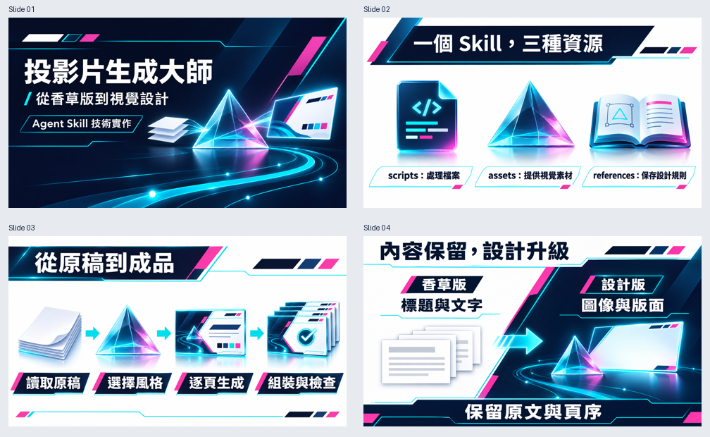

# 投影片生成大師

**把只有標題與文字的香草版 PPTX，交給 Agent 使用 imagegen 逐頁生成完整設計，再輸出新的 PowerPoint。**

先看 [香草版原稿](examples/vanilla.pptx)、[設計版成品](examples/redesigned.pptx)，然後直接打開 [完整 SKILL.md](.agents/skills/slide-master/SKILL.md)。看懂就可以自己改，不必從頭做。



## 先知道成品的形式

每頁都是 imagegen 生成的完整圖片，文字、插圖、圖解與版面一起生成。`assets` 只作視覺參考，不拿來拼貼頁面。Python 只讀取原稿、封裝成品與檢查結構，不負責畫投影片。

輸出 PPTX 的文字已點陣化，不能逐字編輯，原始可編輯 PPTX 會保留。要修改內容，請改原稿並重新生成該頁。示範為四頁，工具並不限制四頁。

## 看檔案就能開始

```text
.agents/skills/slide-master/
  SKILL.md                 六個部分，串起完整流程
  scripts/                 讀取、封裝、結構檢查
  assets/
    style-board.png        視覺風格總覽
    examples/              四頁 imagegen 完整投影片參考
  references/              設計規則、內容保留、Prompt 與品質檢查
examples/
  vanilla.pptx             可編輯的四頁香草版
  redesigned.pptx          imagegen 完整圖片封裝成品
  vanilla.pdf              原稿預覽
  redesigned.pdf           成品預覽
  source.json              逐頁內容與非可見備註
  preview.md               逐頁前後對照
docs/                      課程、操作與修改挑戰
tests/                     可重現的工具測試
```

## 路線 A：不生圖，先在自己電腦重現封裝結果

需要 Python 3.10 以上。在儲存庫根目錄執行，Windows 可將 `python` 換成 `py`。建議使用自己的虛擬環境。

```sh
python -m pip install -r requirements.txt
python .agents/skills/slide-master/scripts/extract_deck.py examples/vanilla.pptx output/work/source.json
python .agents/skills/slide-master/scripts/assemble_deck.py output/work/source.json .agents/skills/slide-master/assets/examples output/reproduced.pptx
python .agents/skills/slide-master/scripts/check_deck.py output/reproduced.pptx --manifest output/work/source.json --images .agents/skills/slide-master/assets/examples
```

這條路線使用已由 imagegen 生成的四頁圖，只示範封裝，不會呼叫 imagegen。重跑請換輸出檔名，腳本不覆寫已有檔案。

## 路線 B：讓 Agent 真正重製一份新簡報

需要具備 **imagegen 與 Python 執行能力** 的 Agent 環境。這個儲存庫不會安裝 imagegen，也沒有用 API key 生圖的隱藏腳本。一般聊天介面是否能讀取本機 Skill，依平台支援而定。

在支援專案 Skill 的環境開啟這個專案，或請 Agent 直接讀取上述 `SKILL.md`，再交付原稿：

> 使用投影片生成大師，將 examples/vanilla.pptx 重新設計成科技風簡報。保留原文、頁數與頁序，每頁必須用 imagegen 生成完整畫面，不能用素材拼貼。保留每頁 Prompt，將圖片與新 PPTX 存在 output/my-redesign。

Agent 會讀原稿、寫 Prompt、呼叫 imagegen、逐頁核對，最後封裝。修改原稿後須重新抽取與生圖，不能直接沿用舊圖。沒有 imagegen 時可以走路線 A 或閱讀範例，不能聲稱完成新一輪 AI 重製。

## 直接修改

- 改視覺：[視覺系統](.agents/skills/slide-master/references/style-system.md)。
- 改生成指示：[實際素材 Prompt](.agents/skills/slide-master/references/asset-prompts.md) 與 [逐頁範本](.agents/skills/slide-master/references/prompt-template.md)。
- 看腳本：[操作示範](docs/demo-guide.md)。
- 自己挑戰：[修改任務](docs/challenges.md)。
- 看三小時安排：[課程大綱](docs/course-outline.md)。

測試：`python -m unittest discover -s tests -v`。自動測試驗證抽取與封裝，不能證明生圖文字正確。中文與圖像仍須逐頁檢視。

## 來源與授權

本專案借鏡教師提供的 Rinne Slide Designer「逐頁整頁生成」流程，另行撰寫教學 Skill 與腳本，沒有收錄 Rinne 原始程式、角色或參考圖片。五張視覺素材由內建 imagegen 新生成，Prompt 隨附。程式與文件採 MIT 授權；生成圖片作為課堂範例隨附，不代表真人或實際事件。
