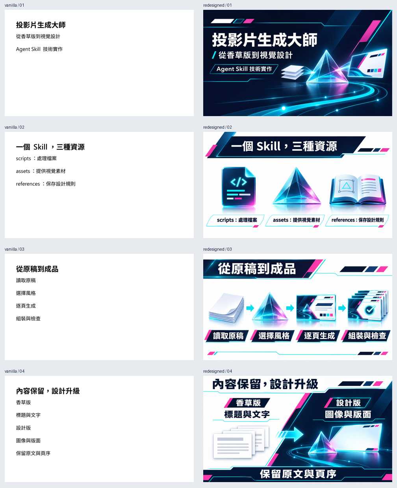
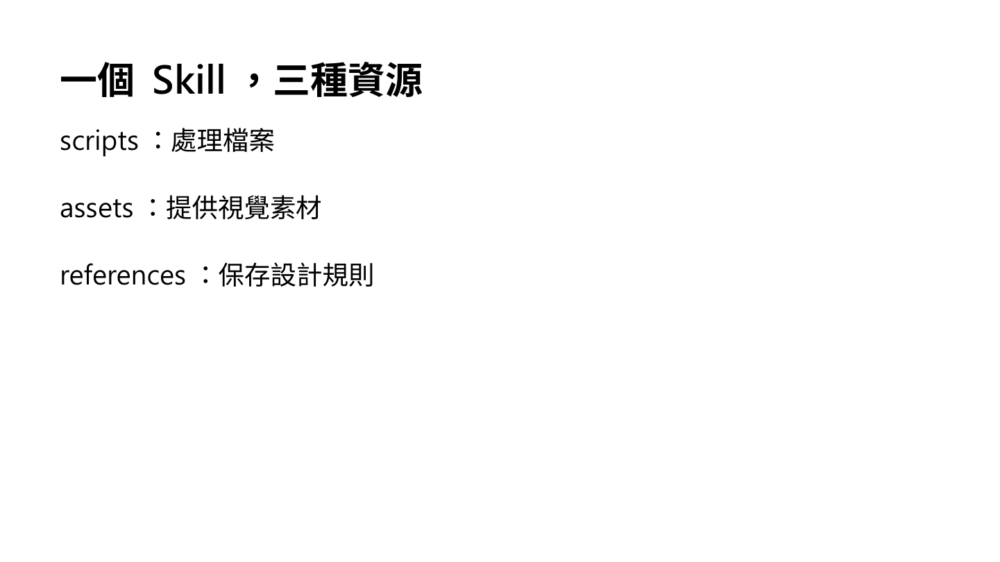
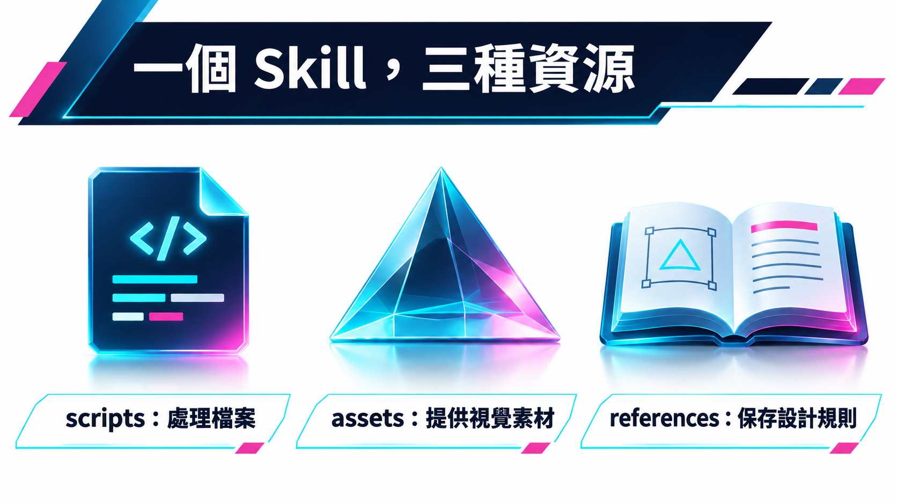
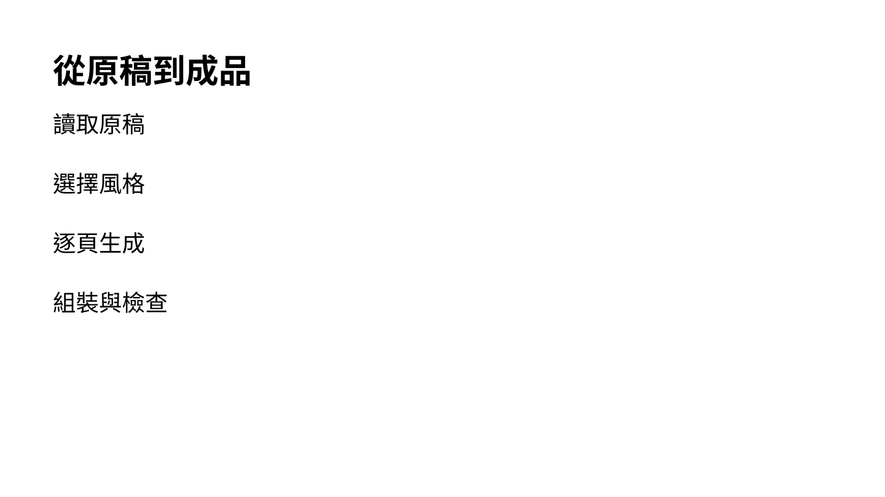
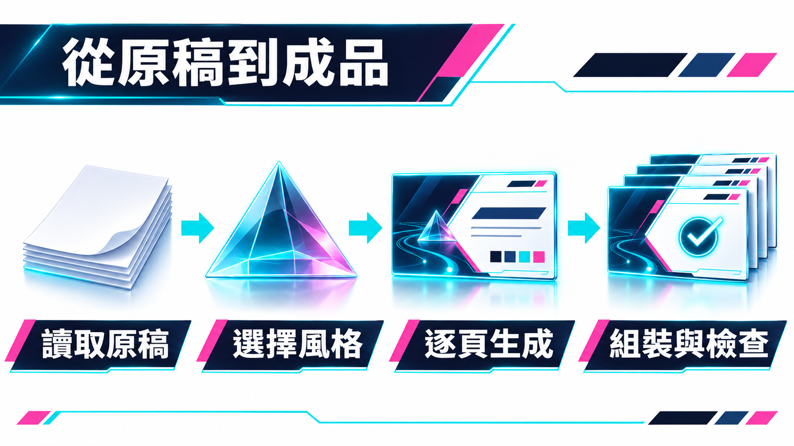

# 原稿與 imagegen 成品對照

每頁右圖皆由 imagegen 一次生成完整畫面，Python 僅封裝。原稿可編輯，成品為整頁圖片。

[香草版 PPTX](vanilla.pptx) · [設計版 PPTX](redesigned.pptx) · [原稿 PDF](vanilla.pdf) · [成品 PDF](redesigned.pdf)

## 第 1 頁

原稿：

imagegen 完整生成：

## 第 2 頁

原稿：

imagegen 完整生成：

## 第 3 頁

原稿：

imagegen 完整生成：

## 第 4 頁

原稿：

imagegen 完整生成：

